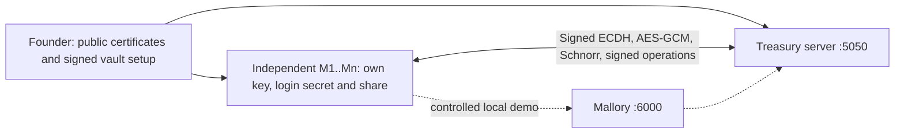

# Cryptographic Treasury System

German International University, ICS505 Cryptography. Deadline: 12 December 2026.
GROUP: `16002216-16003727-16004417-16005162`.

John: identities, certificates, secure channel, integration. Essam: Schnorr login and signed requests. Divan: Shamir/Feldman and threshold vault. Yassin: homomorphic voting. Original commits remain in Git history. Name-to-student-ID mapping still needs team confirmation.

The three milestones run in one Python `treasury` package using independent owner processes and framed TCP on localhost. Secure mode is the default. Streamlit is deferred.



Python 3.10/3.12, cryptography, pytest; optional Wireshark/Npcap and ReportLab. Shared parameters are RFC 3526 Group 14, q=(p-1)/2, g=4, default t=3/n=5. Protocols: P-256 ECDSA/ECDH, HKDF-SHA256, AES-256-GCM, Schnorr, Shamir/Feldman, ElGamal and Chaum-Pedersen proofs.

## Install and test

From the repository root, Windows PowerShell:

```powershell
python -m venv .venv
.\.venv\Scripts\Activate.ps1
python -m pip install -r requirements-dev.txt
python -m pytest -v
```

Linux/macOS:

```sh
python3 -m venv .venv
. .venv/bin/activate
python -m pip install -r requirements-dev.txt
python -m pytest -v
```

Run demos sequentially: ports 5050 and 6000 must be free. Every demo creates a new ignored runtime directory, starts real CLI subprocesses, checks results and stops its own processes. It never deletes prior runs or loads member private files in the controller.

```sh
python -m treasury.demo secure
python -m treasury.demo vault
python -m treasury.demo vault --n 4 --t 2
python -m treasury.demo vault --n 5 --t 4
python -m treasury.demo vote --votes 1,1,1,1,1
python -m treasury.demo vote --votes 0,0,0,0,0
python -m treasury.demo vote --votes 1,0,1,0,1
python -m treasury.demo vote --votes 1,0,1,0,0
```

`vault` verifies M1/M3/M5 and M2/M4/M5 recover identical input bytes; before the third share the operation remains collecting. Changing n/t creates a fresh setup. Voting always requires at least three yes votes, independently of t.

## Manual independent processes

Use a NEW data directory each time (replace `runtime/live1` everywhere). Never reuse a setup with different parameters. Each owner initializes its own identity; founder reads published keys and is the sole setup exception allowed to distribute shares. These commands work in both shells:

```sh
python -m treasury.server --init-identity --data-dir runtime/live1
python -m treasury.member --name M1 --init-identity --data-dir runtime/live1
python -m treasury.member --name M2 --init-identity --data-dir runtime/live1
python -m treasury.member --name M3 --init-identity --data-dir runtime/live1
python -m treasury.member --name M4 --init-identity --data-dir runtime/live1
python -m treasury.member --name M5 --init-identity --data-dir runtime/live1
python -m treasury.founder --n 5 --t 3 --data-dir runtime/live1
python -m treasury.server --data-dir runtime/live1
```

The last command stays running in its terminal. Activate the same virtual environment in additional member terminals. Founder optionally accepts `--vault-file PATH`. Existing setup files cause refusal before replacement. A new directory is the safe fresh-start mechanism.

```sh
python -m treasury.member --name M1 --data-dir runtime/live1 --login interactive
python -m treasury.member --name M2 --data-dir runtime/live1 --login noninteractive
python -m treasury.member --name M1 --data-dir runtime/live1 --command request --op ping
python -m treasury.member --name M1 --data-dir runtime/live1 --command spend --amount 50 --reason pizza
python -m treasury.member --name M2 --data-dir runtime/live1 --command ledger
```

Each command creates a fresh secure connection and authenticates before the operation. A `probe` only tests transport and never authenticates. A spend starts a vote; it does not approve payment. Sequence numbers persist and rejected operations do not consume them.

### Vault

```sh
python -m treasury.member --name M1 --data-dir runtime/live1 --command open-vault
```

Copy the returned `result.id` into OPERATION_ID below (this is a placeholder, not a literal identifier). Each member reads only its own share:

```sh
python -m treasury.member --name M1 --data-dir runtime/live1 --command contribute --operation OPERATION_ID
python -m treasury.member --name M3 --data-dir runtime/live1 --command contribute --operation OPERATION_ID
python -m treasury.member --name M5 --data-dir runtime/live1 --command contribute --operation OPERATION_ID --output runtime/recovered.txt
```

Two contributions remain `collecting`; the third opens the file. Create another opening ID and use M2/M4/M5 to compare outputs. No process reconstructs the treasury scalar during opening. The server verifies founder-signed commitments and derives verification keys; it never reads member share files.

### Private vote

The first spend on a fresh setup returns vote number 1 and operation ID `vote-1` (use the actual returned ID if different). All n members must ballot before aggregate decryption:

```sh
python -m treasury.member --name M1 --data-dir runtime/live1 --command ballot --vote-number 1 --vote 1
python -m treasury.member --name M2 --data-dir runtime/live1 --command ballot --vote-number 1 --vote 0
python -m treasury.member --name M3 --data-dir runtime/live1 --command ballot --vote-number 1 --vote 1
python -m treasury.member --name M4 --data-dir runtime/live1 --command ballot --vote-number 1 --vote 0
python -m treasury.member --name M5 --data-dir runtime/live1 --command ballot --vote-number 1 --vote 1
```

Contribute with M1/M3/M5 using the returned vote operation ID exactly as for a vault opening. Status is available with `--command status --operation OPERATION_ID`. The final tally is three and approval is true; individual plaintext votes never reach the server. Do not reuse an opening's proof in a vote.

## Controlled local attacks

Explain goal/weakness, show weak failure, then show the check blocking the same action:

```sh
python -m treasury.demo A1
python -m treasury.demo A5
python -m treasury.demo A7
python -m treasury.demo A3
python -m treasury.demo replay
```

- A1: unsigned handshake lets Mallory see login traffic. Signed-request modification is still rejected. Secure handshake rejects Mallory's substituted key.
- A5: M3 multiplies its partial decryption by g in BOTH runs. Without proof checks vault authentication fails. Secure verification rejects M3, then M4 substitutes and recovery succeeds.
- A7: Mallory changes c2 to c2*g. The unsigned-ballot tally changes from two to three; signed ballots reject the change and tally two. Both comparisons deliberately keep the unsigned-handshake carrier constant to isolate ballot signatures. The separate A1 secure run proves the fully secure transport blocks interception.
- A3: owner's signing identity is available but its independent login secret is not read. A guessed 4-bit challenge can pass; the secure 128-bit trial rejects eight attempts. This is probabilistic evidence, not an exhaustive security proof.
- Replay: replaying an encrypted frame closes the connection on counter validation.

Weak flags are explicit local CLI options, logged and never accepted from remote application messages. Never use the demo modes with real secrets.

## Wireshark evidence

Install Wireshark with loopback capture support. In PowerShell identify the current interface (10 was Npcap Loopback here):

```powershell
& 'C:\Program Files\Wireshark\tshark.exe' -D
python scripts/run_captures.py --scenario plain --interface 10
python scripts/run_captures.py --scenario secure --interface 10
python scripts/run_captures.py --scenario A1 --interface 10
python scripts/run_captures.py --scenario A3 --interface 10
python scripts/run_captures.py --scenario replay --interface 10
```

Linux: use `--interface lo --tshark /usr/bin/tshark`; macOS typically uses `lo0`. Required capture permission depends on the host. Each run stores a real pcapng, matching per-process logs, result and validation JSON with source hashes. Increase `--duration` if a scenario exceeds 45 seconds. Filter: `tcp.port == 5050 || tcp.port == 6000`. Follow TCP streams: plain exposes login/request; secure shows public handshake plus encrypted records; A1 has separate proxy legs; replay duplicates ciphertext and logs nonce rejection. Preserve old captures as historical evidence, not proof of final behavior. Fresh evidence is under `captures/integrated/`. The Overview lists six captures, while Milestone 1 makes A3/A4 conditional on selected attacks. A3 is included; A4 was not selected. Ask the TA whether the sixth A4 capture is still required; do not treat this discrepancy as resolved.

## Source map and security limits

`treasury/`: config/encoding, identities/certificates/channel/framing, login/requests, sharing/opening/vault, voting, application/ledger/client and CLI roles. `src/` is a migration notice only. `tests/` covers every contributor plus actual CLI subprocesses. `scripts/` generates evidence/design PDF. `runtime/` is ignored private state; `docs/` contains guides and the final report.

Founder and local filesystem are trusted. Process ownership is an application boundary, not an OS sandbox: separate OS accounts/ACLs are required against hostile same-machine users. Run ONE server per data directory; transactions serialize its threads and atomically replace state, but do not coordinate multiple server processes. Server state contains recovered vault bytes after authorized opening and needs protection. No guarantee of physical zeroization exists for immutable Python integers/bytes. No production hardening, external PKI or denial-of-service guarantees are claimed.

Signatures prove ballot origin, not that its plaintext is 0 or 1. A malicious member can encrypt another value; bounded tally recovery detects some invalid totals, but not every invalid ballot. A suitable zero-knowledge bit-validity proof is future work. All-n ballot collection can be stalled by an absent member. Threshold collusion can defeat privacy. Certificates expire; tests cover expiry and evaluation must use valid certificates.

## Evaluation and submission

See [live guide](docs/LIVE_EVALUATION_GUIDE.md), [technical guide](docs/TECHNICAL_GUIDE.md), [integration API](docs/INTEGRATION.md), [four-page design sheet](docs/DESIGN_SHEET.pdf) and [final report](docs/FINAL_IMPLEMENTATION_REPORT.md).

The team must confirm name-ID mapping, make the repository private and invite the specified TA with explicit authorization, record each attack in at most three minutes, and rehearse the 15-minute evaluation. These administrative/manual tasks are not implied complete by passing tests. The integration PR remains unmerged pending approval. Future UI work belongs on `feature/john-streamlit-dashboard` and must call owner-side clients without bypassing authentication.
